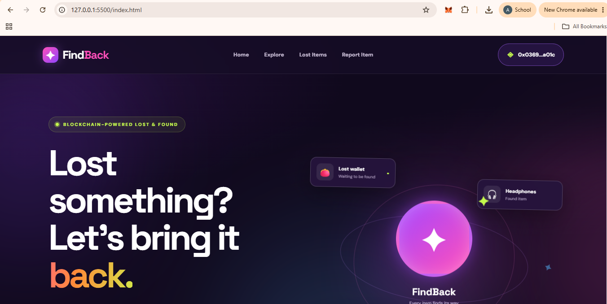
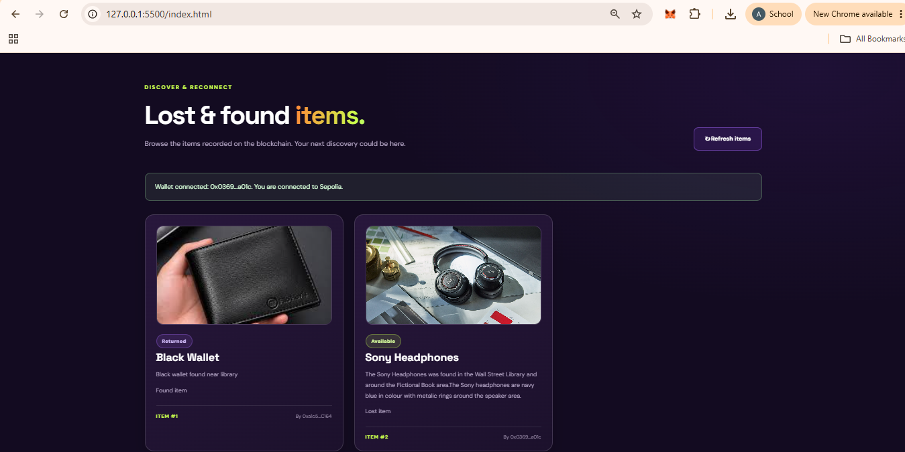
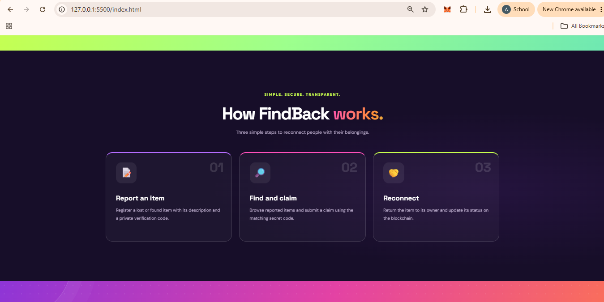
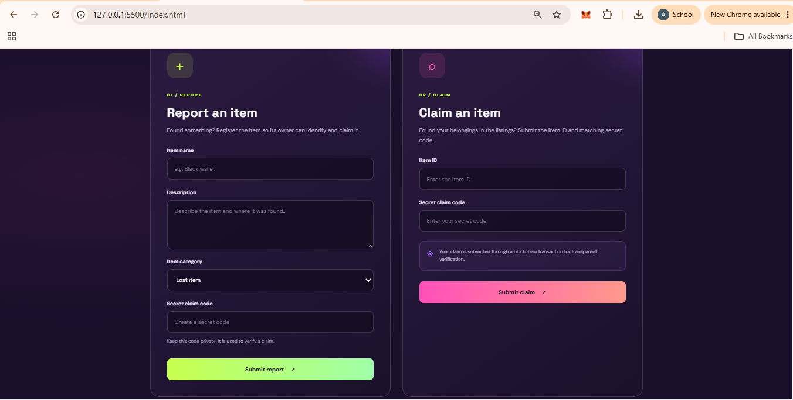

# FindBack – Blockchain-Based Lost-and-Found DApp

## 1. Project Description

FindBack is a decentralized lost-and-found application developed using blockchain technology. It provides a transparent and reliable platform for reporting lost or found belongings and allowing their rightful owners to claim them.

The application uses a Solidity-based smart contract deployed on the Ethereum Sepolia test network. Users can interact with the application through a web-based frontend connected to MetaMask.

FindBack incorporates a secret-code-based verification mechanism for item claims. The item owner provides a verification code, which is used during the claiming process to help establish whether a claimant knows the required information.

By combining smart contracts, wallet authentication, and a simple user interface, FindBack demonstrates a practical application of blockchain technology for managing lost-and-found records.

## 2. Project Objectives

- Develop a decentralized lost-and-found application using Solidity.
- Enable users to report lost and found belongings.
- Provide a platform to explore reported items.
- Implement secret-code-based item claim verification.
- Allow users to update the status of items when they are returned.
- Integrate MetaMask for wallet-based blockchain interaction.
- Demonstrate smart contract functionality using the Sepolia test network.

## 3. Features

### 3.1 MetaMask Wallet Integration
Users can connect their MetaMask wallets to interact with the FindBack smart contract.

### 3.2 Report Item
Users can report lost or found belongings by submitting the required item information through the Report Item interface.

### 3.3 Explore Items
Users can browse the items recorded on the blockchain and view their descriptions, categories, identifiers, and current statuses.

### 3.4 Claim Item
Users can initiate an item claim by providing the required verification code. The smart contract checks the submitted information according to its claim verification logic.

### 3.5 Return Confirmation
The application provides functionality to mark an item as returned, updating its status through the smart contract.

### 3.6 Blockchain-Based Records
Item information and relevant status changes are managed through the deployed smart contract on the Sepolia test network.

## 4. Technologies Used

| Technology | Purpose |
|---|---|
| Solidity | Smart contract development |
| Ethereum Sepolia | Blockchain test network |
| HTML5 | Frontend structure |
| CSS3 | Frontend styling |
| JavaScript | Frontend functionality |
| ethers.js | Blockchain interaction |
| MetaMask | Wallet connection and transaction authorization |
| Remix IDE | Smart contract compilation and deployment |
| GitHub | Project source code and documentation |

## 5. Smart Contract Details

The FindBack smart contract is written in Solidity and deployed on the Ethereum Sepolia test network.

**Blockchain:** Ethereum  
**Network:** Sepolia Testnet

**Deployed Contract Address:**

`0xf9520B003Cf35132B15914D9620beC85A2F38CB9`

**Contract Explorer:**

https://sepolia.etherscan.io/address/0xf9520B003Cf35132B15914D9620beC85A2F38CB9

The deployed contract can be inspected through Etherscan, where its available source code, ABI, transactions, and contract interaction interfaces can be viewed.

## 6. Smart Contract Functions

The FindBack smart contract includes the following main functions:

| Function | Description |
|---|---|
| `reportItem()` | Records a new lost or found item. |
| `claimItem()` | Processes an item claim using the required verification code. |
| `markReturned()` | Updates an item's status to returned. |
| `getItem()` | Retrieves the details of a reported item. |
| `itemCount()` | Returns the total number of recorded items. |

These functions allow users to interact with the lost-and-found records through blockchain transactions and smart contract calls.

## 7. Smart Contract Deployment Steps

The smart contract was developed and deployed using Remix IDE.

The following steps describe the deployment process:

1. Open Remix IDE: https://remix.ethereum.org/
2. Create a new Solidity file named `FindBack.sol`.
3. Copy the FindBack smart contract source code into the file.
4. Select the appropriate Solidity compiler version.
5. Compile the smart contract.
6. Install and configure MetaMask in the browser.
7. Select the Sepolia test network in MetaMask.
8. Open the Deploy & Run Transactions section in Remix.
9. Select Injected Provider - MetaMask as the environment.
10. Confirm that Remix is connected to the Sepolia network.
11. Select the FindBack contract and click Deploy.
12. Approve the deployment transaction through MetaMask.
13. Once the transaction is confirmed, retrieve the deployed contract address.
14. Copy the contract ABI and deployed address for frontend integration.

**Note:** The contract address provided in Section 5 is the existing FindBack deployment. The deployment steps above describe how to deploy a new instance; redeployment is not required to run the existing application.

## 8. Frontend Setup and Execution

### 8.1 Prerequisites

The following are required to run the FindBack frontend:

- A web browser such as Google Chrome.
- MetaMask browser extension.
- Access to the Ethereum Sepolia test network.
- Sepolia test ETH for transactions that require gas fees.
- Visual Studio Code or another code editor.
- A local development server, such as the VS Code Live Server extension.

### 8.2 Repository Setup

Clone the repository using:

```bash
git clone https://github.com/AnohaAnnCherian/FindBack-.git
```

Navigate to the project directory:

```bash
cd FindBack-
```

### 8.3 Configure the Frontend

1. Open the `frontend` folder.
2. Locate the JavaScript file responsible for blockchain interaction.
3. Ensure that the deployed contract address is configured correctly.
4. Ensure that the contract ABI matches the deployed Solidity contract.
5. Verify that the frontend uses the appropriate ethers.js configuration.
6. Ensure MetaMask is connected to the Sepolia test network.

### 8.4 Run the Application

1. Open the project folder in Visual Studio Code.
2. Open the `frontend` folder.
3. Install the Live Server extension if it is not already installed.
4. Right-click `index.html`.
5. Select **Open with Live Server**.
6. The FindBack application will open in your default browser.
7. Connect your MetaMask wallet.
8. Confirm that the selected blockchain network is Sepolia.
9. Explore the application and interact with the available functionalities.

## 9. Application Workflow

The general workflow of the FindBack application is as follows:

1. **Connect Wallet:** The user connects their MetaMask wallet to the application.
2. **Report Item:** The user submits information about a lost or found item.
3. **Explore Items:** Users browse the available item records.
4. **Claim Item:** A claimant provides the required verification code to initiate the claim.
5. **Return Item:** The appropriate user performs the return confirmation operation.
6. **Status Update:** The item's status is updated through the smart contract.

## 10. Application Screenshots

The following screenshots illustrate the user interface and major functionalities of the FindBack decentralized application.

### Figure 1. FindBack Home Page



**Description:**

The home page introduces the FindBack decentralized lost-and-found application. It displays the application branding, navigation menu, and the main introductory section explaining the purpose of the platform. The connected MetaMask wallet is also visible in the navigation bar.

### Figure 2. Explore Items – Blockchain-Based Item Listings



**Description:**

The Explore section displays the lost-and-found records available in the application. Each item is presented through an individual card containing its image, item name, description, category, item identifier, and current status. Users can browse the recorded items and distinguish between available and returned items. The interface also displays the connected wallet and Sepolia network status.

### Figure 3. FindBack Application Workflow



**Description:**

This screenshot demonstrates the working interface of FindBack and its main application workflow. It illustrates how users navigate through the application to report belongings, explore item records, and initiate the claiming process. The screenshot highlights the interaction between the frontend interface and the blockchain-based application.

### Figure 4. Report Item and Claim Item Interfaces



**Description:**

This screenshot presents the Report Item and Claim Item dialogue interfaces. The Report Item dialogue provides fields for submitting the required information about a lost or found belonging. The Claim Item dialogue allows a user to enter the required item identification and verification information to initiate a claim. These interfaces provide the primary user interaction mechanisms for reporting and claiming items.

## 11. Repository Structure

The project is organized into the following directories and files:

```text
FindBack-/
│
├── contracts/
│   └── FindBack.sol
│
├── frontend/
│   ├── index.html
│   ├── style.css
│   └── app.js
│
├── screenshots/
│   ├── findback-home.png
│   ├── explore-items.png
│   ├── application-workflow.png
│   └── report-claim-dialogues.png
│
└── README.md
```

## 12. Test Network Information

**Blockchain:** Ethereum  
**Test Network:** Sepolia  
**Wallet:** MetaMask  
**Development Environment:** Remix IDE  
**Block Explorer:** https://sepolia.etherscan.io/

**Deployed Contract Address:**

`0xf9520B003Cf35132B15914D9620beC85A2F38CB9`

## 13. Conclusion

FindBack demonstrates the practical use of blockchain technology in developing a decentralized lost-and-found application. By integrating Solidity smart contracts, MetaMask wallet connectivity, and a web-based frontend, the application provides functionality for reporting, exploring, claiming, and returning lost belongings.

The project highlights how blockchain-based records and smart contract interactions can be applied to everyday problems while demonstrating the fundamentals of decentralized application development.

---

**Project Name:** FindBack – Blockchain-Based Lost-and-Found DApp  
**Blockchain Network:** Ethereum Sepolia Testnet  
**Repository:** https://github.com/AnohaAnnCherian/FindBack-
